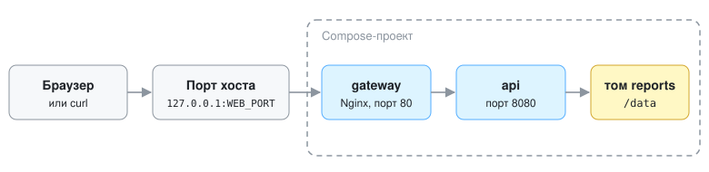
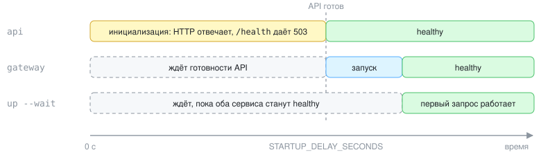

# Часть 6. Собрать всё в Compose • 2,5 балла

Коллегам нужен один адрес и для страницы, и для API. В этой части вы поставите перед API шлюз Nginx и соберёте оба сервиса в Compose. Менять нужно `compose.yaml`, `gateway/nginx.conf` и версию в `app/settings.py`. Исходники и Dockerfile шлюза уже готовы. Код и конфигурация должны входить в образы, а не монтироваться с хоста.



Запускайте основной проект командой `docker compose -p hw3-lab …`.

## 6.1. Связь сервисов: найти причину 502 • 0,75 балла

1. В начальном `compose.yaml` есть только `api`, опубликованный на `127.0.0.1:${WEB_PORT:-18090}:8080`. Добавьте именованный том проекта `reports` и подключите его к `/data`. Том `reports-data` из части 5 сам не перенесётся.

2. Создайте `.env` из `.env.example`. Если порт `18090` занят, задайте в `.env` другой свободный `WEB_PORT`.

3. Запустите API и дождитесь ответа `/health`.

4. Добавьте `gateway` из `gateway/service.example.yaml` и отдайте внешний порт ему. API больше не публикует порт на хосте. Том при этом не удаляйте.

Запрос через шлюз вернёт 502. Найдите причину и исправьте конфигурацию. В образ шлюза уже входят Nginx и `wget`.

**Требования:**

- Через один внешний адрес работают страница, загрузка CSV и чтение отчёта.
- Пути `/health` и `/reports` не меняются.
- Адрес API не зависит от IP контейнера.

## 6.2. Готовность и восстановление • 0,75 балла

### Дождаться готовности

Переменная `STARTUP_DELAY_SECONDS=15` включает 15-секундную инициализацию: HTTP уже доступен, но `/health` и операции с отчётами отвечают 503. Код сервера менять не нужно.



1. Удалите контейнеры проекта, том сохраните. Задайте задержку `15` и запустите проект. Сравните состояние контейнеров, ответ `/health` через шлюз и логи до и после того, как API стал готов.

2. Настройте порядок запуска и healthcheck обоих сервисов по требованиям ниже.

3. Снова удалите контейнеры, сохранив том, и запустите:

   ```bash
   docker compose -p hw3-lab up -d --build --wait --wait-timeout 60
   ```

**Требования:**

- Шлюз запускается только после того, как API успешно ответил по HTTP.
- Healthcheck API учитывает инициализацию.
- Healthcheck шлюза подтверждает, что работает вся цепочка до API.
- Сразу после успешного `up --wait` первый запрос через шлюз работает.

Проверка меняет задержку от 0 до 15 секунд. Таймаут в 60 секунд относится к ожиданию готовности, а не к сборке. После проверки верните задержку к `0`.

### Восстановиться после отказа API

Отключите автоматический перезапуск обоих сервисов. Остановите только контейнер `api`, не удаляя его. Сравните состояние процесса шлюза, его статус healthcheck и HTTP-ответ.

> **На подумать.** Что произошло автоматически, а чего healthcheck не делает?

Запустите тот же контейнер API.

**Требование:** в течение 60 секунд после запуска API у обоих сервисов восстанавливаются HTTP-доступ и статус `healthy`. Перезапускать шлюз вручную не нужно.

## 6.3. Обновление • 0,5 балла

Создайте через шлюз два контрольных отчёта. После каждого шага ниже проверяйте, что их ID и содержимое не изменились.

1. **Окружение.**
   - Задайте API `INSTANCE_NAME=first` и проверьте значение в `/health`.
   - Измените его на `second` и выполните только `restart api`. Сравните ответ `/health` и ID контейнера с прежними.
   - Примените изменённую конфигурацию. Снова проверьте ответ, ID контейнера, HTTP и `healthy`: всё должно восстановиться за 60 секунд.

2. **Код.** В `app/settings.py` измените версию с `1` на `2`. Сравните обычный `restart` с обновлением после пересборки. В итоге API сообщает версию `2`, а отчёты сохраняют ID и содержимое.

3. **Хранилище.** Выполните `down` без `-v`, снова запустите проект и проверьте отчёты. По справке выясните, что изменил бы флаг `-v`. Рабочий том не удаляйте.

## 6.4. Независимость и лимиты • 0,5 балла

Ограничьте API одним CPU и 256 MiB памяти. Проверьте независимость проектов на [свежем клоне](../README.md#сдача). Пока оба проекта работают, у нового список отчётов должен быть пустым, а у первого должны читаться прежние отчёты.

**Итоговая конфигурация**

- В проекте только `api` и `gateway`. Оба собираются из проекта. Контексты сборки и Dockerfile лежат внутри него.
- Порт `127.0.0.1:${WEB_PORT:-18090}:80` публикует только `gateway`. Шлюз обращается к API по имени `api`. Данные лежат в томе проекта `reports`, подключённом к `/data`.
- Оставьте версию `2`, `INSTANCE_NAME=second` и задержку `0`. У обоих сервисов включён healthcheck и выключен автоматический перезапуск.
- Не используйте `container_name`, bind mount, внешние сети и тома, `driver_opts`, `privileged`, `network_mode` и `devices`.

<details>
<summary><b>По желанию · Как открыть сервис с ВМ в браузере ноутбука?</b></summary>

Если проект запущен на удалённой Linux-ВМ, проверьте на ней `/health` через порт шлюза. Теперь откройте тот же адрес с `127.0.0.1` на ноутбуке. К какой машине обращается браузер?

Настройте локальный SSH-туннель со свободного порта ноутбука на порт шлюза на ВМ. Откройте страницу через туннель, загрузите CSV и найдите отчёт по его ID с ВМ. Закройте туннель. Откуда теперь доступен сервис?

</details>
